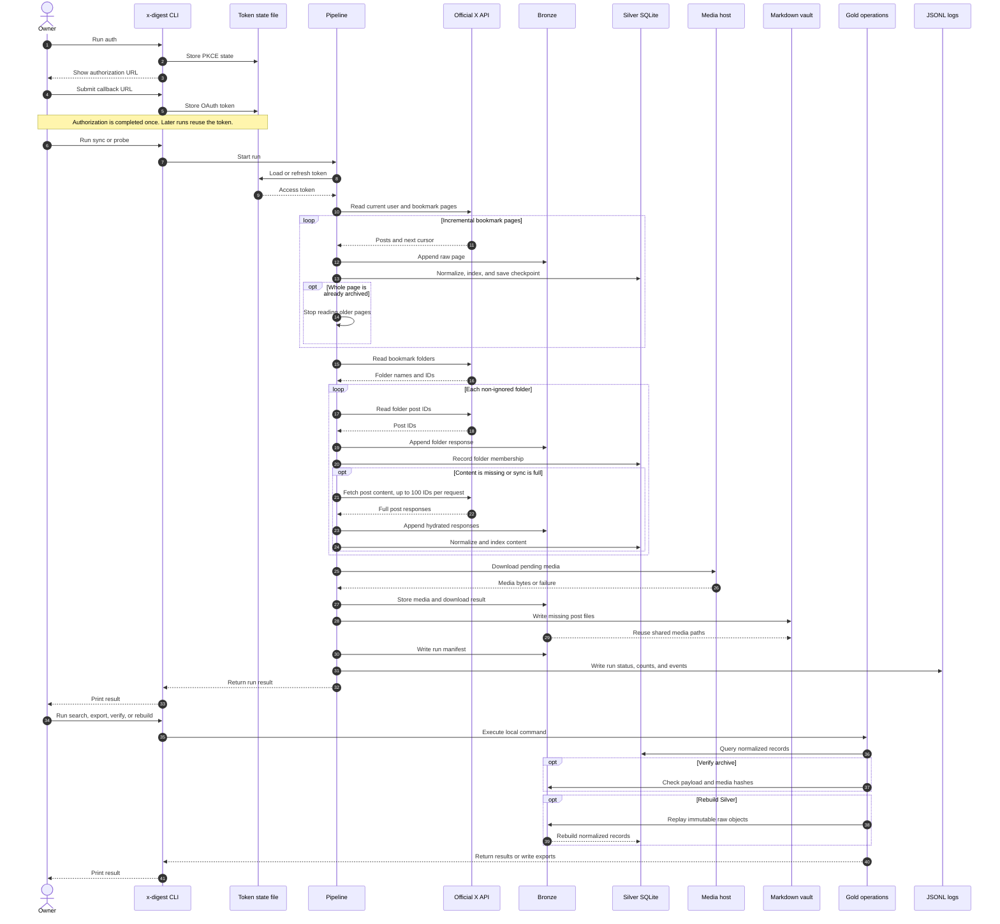

# Imladris Technical Context

This document is the engineering reference for Imladris. Read it before you
change the data model, synchronization flow, authentication flow, or archive
layout. Run commands from the repository root.

For setup, see [the README](../README.md). For routine commands, see
[Usage](usage.md). For scheduling and backups, see [Operations](operations.md).

## 1. Overview

Imladris is a local Python application that archives X bookmarks and the Brave
Reading List. Brave collection uses a separate read-only pipeline (section 2.4). It
uses the official X API through the Python XDK. It stores raw API responses,
normalizes post data into SQLite, downloads referenced media, and provides a
command-line interface for search, inspection, export, and verification.

The application exists to keep a private copy of bookmarked posts independent
of X availability. It is an archive, not a publishing client. The current
version does not create X posts, change bookmarks, or modify Brave. Collection
does not call an LLM. The optional Telegram digest uses OpenRouter to summarize
archived X posts.

The main users are:

- The owner of the bookmark archive.
- Engineers who maintain the local pipeline and its data model.

The default archive is self-contained in the repository:

```text
<project-root>/data/
```

The `data/` directory is ignored by Git. It contains personal archive data and
must not be committed.

## 2. Architecture

Imladris uses a local, three-layer data flow:

```text
                 +----------------------+
                 | X API through XDK    |
                 | OAuth 2.0 PKCE       |
                 +----------+-----------+
                            |
                            v
                 +----------------------+
                 | Pipeline              |
                 | sync and probes       |
                 +----------+-----------+
                            |
              +-------------+-------------+
              |                           |
              v                           v
   +----------------------+    +----------------------+
   | Bronze               |    | Run events and logs  |
   | Immutable raw files  |    | SQLite + JSONL       |
   +----------+-----------+    +----------------------+
              |
              v
   +----------------------+
   | Silver               |
   | Normalized SQLite    |
   | Records and FTS5     |
   +----------+-----------+
              |
              v
   +----------------------+
   | Gold                 |
   | Search, show, export |
   | verify, rebuild      |
   +----------------------+
```

### 2.1 Components

| Component | Location | Responsibility |
| --- | --- | --- |
| CLI | `src/x_digest/cli.py` | Parse commands and route work to the pipeline or local store. |
| Configuration | `src/x_digest/config.py` | Load and validate `XDIGEST_` settings. |
| Authentication | `src/x_digest/auth.py` | Run OAuth 2.0 PKCE and store the token in an owner-only state file. |
| X API adapter | `src/x_digest/x_api.py` | Call the official XDK with timeouts and retries. |
| Pipeline | `src/x_digest/pipeline.py` | Coordinate extraction, Bronze writes, normalization, media, checkpoints, and run state. |
| Bronze writer | `src/x_digest/bronze.py` | Write immutable compressed JSON, manifests, and media. |
| Silver normalizer | `src/x_digest/silver.py` | Map X response shapes to SQLite records. |
| Database | `src/x_digest/db.py` | Create SQLite schema, connections, transactions, and checkpoints. |
| Media downloader | `src/x_digest/media.py` | Download pending media and record independent results. |
| Gold store | `src/x_digest/gold.py` | Query and maintain normalized local data. |
| Process lock | `src/x_digest/lock.py` | Prevent concurrent pipeline runs. |
| Logger | `src/x_digest/logging_setup.py` | Append structured JSON events to the local log. |
| Markdown | `src/x_digest/markdown.py` | Write one Markdown file per newly archived post. |

### 2.2 Main sync sequence

`x-digest sync` performs these steps:

1. Create a UUID for the run.
2. Insert a `running` row into `runs`.
3. Acquire `data/run.lock`.
4. Load the X OAuth token from `state_dir` (`~/.local/state/x-digest/oauth2.json`).
5. Create the XDK client and refresh the token when it is expired.
6. Call the authenticated-user endpoint.
7. Load the bookmark cursor from `checkpoints`.
8. Fetch one bookmark page at a time until the checkpoint ends or a complete
   page contains only already-known posts (incremental stop).
9. Write each page to Bronze.
10. Normalize each page into Silver.
11. Store the next bookmark cursor after each successful page.
12. Fetch bookmark folders and their post IDs.
13. Fetch content for folder posts that are not `complete` in batches of up to
    100 IDs.
14. Normalize posts and folder membership from the hydrated responses.
15. Download media with `pending` status.
16. Write a Markdown file for each new post.
17. Deliver one pending Telegram digest batch through OpenRouter when
    configured. Missing credentials or delivery failures never change the
    archive status; the batch stays pending for the next run.
18. Write the run manifest, including the measured X API usage summary.
19. Mark the run as `success` and record counts.

`sync --full` disables the incremental stop in step 8 and the content skip in
step 13. A fully known bookmark page is never written to Bronze, so the
incremental stop stores nothing extra.

The pipeline marks the run as `failed`, stores the error string, and writes a
failure event when any step raises an exception. The exception then reaches the
CLI caller.

The full sequence diagram shows the OAuth flow, incremental reads, folders,
media, and local commands:



### 2.3 Probe sequences

`probe-post` validates an X or Twitter status URL, fetches one post by ID, and
runs the same Bronze, Silver, and media steps as a normal post capture.

`probe-bookmarks` has a strict bound. It fetches one bookmark page and selects
the first ordinary post and the first post with an `article` object. It then
fetches those two posts individually. It never paginates through the full
bookmark collection. The command fails if the bounded page does not contain
both post types.

The probe exists because X Article response shapes needed direct inspection.
The full Article body is currently extracted from `article.plain_text`.

### 2.4 Brave Reading List collection

Run `uv run --extra brave x-digest brave-sync`. X authorization is not required.
Install Donsetch separately. The optional extra provides the pure-Python
`chromium-reader==0.1.1`; no system LevelDB or Snappy installation is required.
Donsetch is resolved from `PATH`, then `~/.local/bin/donsetch`, or the configured
executable. Preflight failure does not consume item retries.

The pipeline acquires the shared lock, copies the profile LevelDB files, and
retries an unstable copy within the configured bound. The reader honors the
manifest, active tables and logs, sequence numbers, and tombstones. It reads
all Reading List entries regardless of read status. It never opens the live
files as a database or changes Brave settings, entries, or read status. Brave
can remain open. Malformed records and unstable copies cause explicit errors.

`--profile` selects the profile; the fallback is `Default`. `--db-path` overrides
`~/Library/Application Support/BraveSoftware/Brave-Browser/<profile>/Sync Data/LevelDB`.
The temporary copy is removed after reading.

The URL-list snapshot reaches Bronze before content requests. An unchanged
snapshot hash is deduplicated. URL-keyed saved records retain completed content
through metadata changes and deletion from Brave. X/Twitter and Reddit URLs
remain in snapshots but are excluded from webpage collection, including
redirects. Existing archived content is preserved.

Ordinary webpages use the saved URL and normal redirects through Donsetch.
The pipeline does not crawl sites or follow references. Exact PubMed URLs use
NCBI EFetch for the same PMID. The raw XML is retained as base64, with readable
metadata and any abstract. An abstract is not classified as a full paper.

A PMC ID from the URL or PubMed record permits separate PMC EFetch retrieval.
DOI-only saves do not trigger provider discovery. PMC retrieval validates the
article identity, nonempty body, and recognized open license. XML bytes remain
unchanged; linked figures are not downloaded. Explicitly saved PDFs also remain
unchanged. There is no PDF text extraction. NCBI requests share a minimum
0.4-second interval within the fetcher. No email or API key is required.

Source fetch and full-text outcomes are independent. Each has at most
`XDIGEST_SAVED_MAX_ATTEMPTS` total attempts across runs. Network errors,
malformed responses, and empty or truncated extractions remain failures.
Unresolved or exhausted failures cause a nonzero exit. A confirmed unavailable
PMC result does not fail sync or imply that full text is unavailable elsewhere.
Completed and unavailable results are not requested again. Successful PMC XML
does not clear a failed download of the original saved PDF.

| Modules | Responsibility |
| --- | --- |
| `brave.py`, `brave_leveldb.py` | Stable copy and strict Reading List decoding. |
| `saved_pipeline.py` | Snapshot-first collection and run state. |
| `saved_fetch.py`, `pubmed.py` | Webpage, PDF, and exact PubMed record retrieval. |
| `saved_store.py`, `saved_urls.py` | Catalog, search, replay, and exclusions. |
| `fulltext.py`, `fulltext_ids.py`, `fulltext_pmc.py` | Same-item identifiers and validated PMC retrieval. |
| `fulltext_pipeline.py`, `fulltext_store.py` | Full-text retries, archival, and replay. |

## 3. Technology Stack

| Area | Technology | Current constraint |
| --- | --- | --- |
| Language | Python | `>=3.11`; local development currently uses Python 3.14. |
| Package manager | `uv` | Use `uv sync`, `uv run`, and the checked-in `uv.lock`. |
| CLI | Python `argparse` | Entry point is `x-digest`. |
| API client | `xdk` | `>=0.10.0`; use only official X API operations. |
| Settings | `pydantic-settings` | `>=2.14.2`; environment prefix is `XDIGEST_`. |
| Static secrets | `pass-cli` | Reads Proton Pass fields from the machine's secrets vault. |
| OAuth token | Owner-only JSON file | `state_dir/oauth2.json`, mode 0600. |
| Database | SQLite | WAL mode and foreign keys are enabled. |
| Search | SQLite FTS5 | Falls back to `LIKE` when an FTS query cannot run. |
| HTTP transport | `requests` through XDK and `urllib` for media | API and media timeouts are configurable. |
| Test runner | `pytest` | Development dependency; tests use real SQLite and files. |
| Linter and formatter | `ruff` | Configuration is in `pyproject.toml`. |

The package metadata and command entry point are in `pyproject.toml`. The
project has no web server, queue, cloud database, container, or deployment
service.

## 4. Key Decisions

There is no separate `docs/adr/` directory yet. The decisions below are the
current architecture record.

### 4.1 Use the official X API and XDK

**Decision:** Use the official Python XDK for OAuth, bookmark reads, folder
reads, post reads, and response models.

**Reason:** The archive must use a supported API and must not depend on browser
cookies, scraping, or undocumented endpoints.

**Trade-off:** Access depends on X API permissions, quotas, response fields,
and account access. The application cannot recover fields that X does not
return.

### 4.2 Use OAuth 2.0 PKCE with read-only scopes

**Decision:** Request `bookmark.read`, `tweet.read`, `users.read`, and
`offline.access`. Do not request `tweet.write`.

**Reason:** PKCE supports a local user authorization flow without putting a
client secret into source code. The scope limits the application to archive
reads.

**Trade-off:** The user must complete browser authorization. The token remains
account-specific and depends on the X authorization grant.

### 4.3 Make Bronze append-only

**Decision:** Store every successful raw response as a new compressed JSON
object. Never update or delete a Bronze object during normal application use.

**Reason:** Bronze is the source of truth. A later normalizer can rebuild
derived records from the exact captured responses.

**Trade-off:** Storage grows over time. Repeated observations of an unchanged
post still create additional raw observations.

### 4.4 Use SQLite for Silver and Gold

**Decision:** Keep normalized data, provenance, run state, and search in one
local SQLite database.

**Reason:** The project is single-user and local. SQLite provides transactions,
foreign keys, WAL mode, FTS5, and simple backup and inspection.

**Trade-off:** The application is not designed for concurrent writers,
multi-user access, or high-volume distributed ingestion.

### 4.5 Use project-local `data/` as the default vault

**Decision:** Resolve the project root by walking up to `pyproject.toml` and
use `<project-root>/data` as the default vault. Allow
`XDIGEST_VAULT_PATH` to override it.

**Reason:** The owner requested a self-contained project. Code, configuration,
and archive files can move together.

**Trade-off:** The archive is personal data inside the project directory. Git
ignores `data/`, but file permissions and backups remain the operator's
responsibility.

### 4.6 Use atomic files and transactional database writes

**Decision:** Write files to temporary files, flush them, call `fsync`, and
replace the destination. Use SQLite transactions for related database changes.

**Reason:** A process or machine failure must not leave a partially written
archive object or a partially applied normalized record.

**Trade-off:** Atomic replacement does not make an already completed API call
reversible. It also does not protect against a disk failure or an operator who
edits files manually.

### 4.7 Store immutable content versions and observations

**Decision:** Keep one `post_versions` row for each normalized content hash and
one `post_observations` row for each post and Bronze object pair.

**Reason:** The current post projection is useful for queries, while versions
and observations preserve change history and source provenance.

**Trade-off:** The schema is more complex than one row per post. Rebuild and
query code must preserve the relationships.

### 4.8 Use checkpoints after each bookmark page

**Decision:** Store the next X pagination token under `bookmarks:<user_id>`
after each successfully normalized page.

**Reason:** A later sync can resume after a failure instead of starting at the
first page every time.

**Trade-off:** The checkpoint tracks the extractor cursor, not a complete
transaction across all later folder and media work. A failure after a page is
committed can leave later phases for a future run.

### 4.9 Keep the CLI as the first interface

**Decision:** Expose authentication, sync, search, inspection, export,
verification, and rebuild through `argparse`.

**Reason:** A CLI is easy to automate, inspect, test, and run manually.

**Trade-off:** There is no browser UI or interactive archive browser.

## 5. Repository Layout

```text
imladris/
├── .env.example              # Local OAuth configuration template
├── .gitignore                # Excludes secrets, local data, and generated files
├── README.md                 # Setup guide
├── docs/
│   ├── usage.md              # Commands and collection behavior
│   ├── operations.md         # Scheduling, digest, and backup setup
│   └── tech-context.md       # This engineering reference
├── pyproject.toml            # Package metadata, dependencies, tools
├── uv.lock                   # Resolved dependency versions
├── data/                     # Local vault; ignored by Git
│   ├── bronze/               # Immutable compressed responses and media
│   ├── logs/                 # JSONL application logs
│   ├── silver.sqlite         # Silver and Gold database
│   ├── run.lock              # Present only while a pipeline owns the lock
├── src/x_digest/             # Application package
└── tests/                    # Integration tests
```

The `inspection/` directory is also ignored. It is intended for local Markdown
exports from `export-post`.

### 5.1 Source module map

| Module | Main types and functions | Notes |
| --- | --- | --- |
| `config.py` | `Settings`, `load_settings` | Validates environment settings and computes vault paths. |
| `auth.py` | `TokenStore`, `authorization_url`, `exchange_callback`, `authenticated_client` | Owns PKCE state and token access. |
| `x_api.py` | `XApi`, `TimeoutSession`, `model_dict` | Defines requested X fields and retry behavior. |
| `db.py` | `Database`, `utc_now` | Creates schema and transaction boundaries. |
| `bronze.py` | `BronzeWriter`, `BronzeWriteRequest` | Owns raw object layout, hashes, manifests, and media writes. |
| `silver.py` | `SilverNormalizer` | Converts API payloads into relational records. |
| `media.py` | `MediaDownloader` | Handles media download limits and status updates. |
| `pipeline.py` | `Pipeline` | Coordinates all write stages. |
| `gold.py` | `GoldStore` | Implements local reads, exports, verification, and rebuild. |
| `lock.py` | `ProcessLock` | Provides exclusive pipeline ownership. |
| `logging_setup.py` | `JsonlLogger` | Writes durable event lines. |
| `cli.py` | `build_parser`, `main` | Defines the user-facing command surface. |

## 6. Local Development

### 6.1 Set up the environment

Run these commands from the repository root:

```bash
uv sync
uv run x-digest --help
```

The package uses the `uv` environment. Do not install a second copy of the
application into the system Python for normal development.

### 6.2 Configure X

Copy the values from `.env.example` into a local `.env` file:

```text
XDIGEST_X_CLIENT_ID=your-client-id
XDIGEST_X_CLIENT_SECRET=optional-client-secret
XDIGEST_X_REDIRECT_URI=http://localhost:8080/callback
XDIGEST_X_SCOPE=bookmark.read tweet.read users.read offline.access
```

Register the same redirect URI in the X Developer Console. Keep `.env` local.
The client secret is stored in `.env` as plain text, so protect the file with
normal user file permissions.

The empty value for `XDIGEST_X_SCOPE` is replaced with the read-only default by
the validator in `config.py`. This prevents an empty `.env` assignment from
creating an invalid OAuth request.

### 6.3 Authorize the account

Start the first phase:

```bash
uv run x-digest auth
```

Open the printed URL. After authorization, copy the complete callback URL and
run the second phase:

```bash
uv run x-digest auth --callback-url 'http://localhost:8080/callback?code=...&state=...'
```

The token and short-lived PKCE state are stored as owner-only files in
`state_dir`: `oauth2.json` and `pkce.json`, written with mode 0600 by an
atomic replace. The token is not stored in SQLite, the Bronze archive, or the
application log.

### 6.4 Run the application

Run a complete bookmark sync:

```bash
uv run x-digest sync
```

Run one bounded page without writing archive content:

```bash
uv run x-digest sync --max-pages 1 --dry-run
```

Probe one ordinary post and one Article from one bookmark page:

```bash
uv run x-digest probe-bookmarks --max-results 20
```

Probe one post by canonical URL:

```bash
uv run x-digest probe-post 'https://x.com/user/status/1234567890'
```

### 6.5 Query and export local data

```bash
uv run x-digest status
uv run x-digest search "machine learning"
uv run x-digest search "machine learning" --limit 50
uv run x-digest show 2079312247239667752
uv run x-digest export-post 2079312247239667752 --output inspection/post.md
uv run x-digest export --format markdown
uv run x-digest export --format json --output inspection/bookmarks.json
```

The bulk Markdown export is one file with post blocks separated by `---`. The
single-post export includes YAML-style metadata and the selected body. For an
Article, the body is `article_body`, which comes from `article.plain_text`.

### 6.6 Run checks

Run the test suite:

```bash
uv run pytest
```

Run formatting and lint checks:

```bash
uv run ruff format src tests
uv run ruff check src tests
```

Run archive verification:

```bash
uv run x-digest verify
uv run x-digest verify --full
```

`verify` checks Bronze compressed JSON and sidecar manifests. `verify --full`
also checks hashes for downloaded media, saved PDFs, and full-text XML.

### 6.7 Override the vault for tests or experiments

Use a separate directory when you need an isolated database:

```bash
XDIGEST_VAULT_PATH=/tmp/x-digest-test uv run x-digest status
```

The test suite uses `tmp_path` and does not touch the repository `data/`
directory.

## 7. Configuration Reference

All environment settings use the `XDIGEST_` prefix, except two Telegram
aliases kept for existing local setups: `TELEGRAM_BOT_TOKEN` is an alias for
`XDIGEST_TELEGRAM_BOT_TOKEN`, and `TELEGRAM_USER_ID` is an alias for
`XDIGEST_TELEGRAM_CHAT_ID`. Pydantic validates numeric
limits when `Settings` loads.

| Environment variable | Default | Purpose |
| --- | --- | --- |
| `XDIGEST_VAULT_PATH` | `<project-root>/data` | Root for Bronze, SQLite, logs, and lock. |
| `XDIGEST_X_CLIENT_ID` | None | X Developer application client ID. Required for auth. |
| `XDIGEST_X_CLIENT_SECRET` | None | Optional X client secret. |
| `XDIGEST_X_REDIRECT_URI` | `http://localhost:8080/callback` | OAuth callback URI. |
| `XDIGEST_X_SCOPE` | `bookmark.read tweet.read users.read offline.access` | OAuth read scopes. |
| `XDIGEST_KEYCHAIN_SERVICE` | `x-digest` | Keychain service name, used only for the optional Telegram token fallback. |
| `XDIGEST_SECRETS_VAULT` | `your-vault` | Proton Pass vault that holds the static secrets. An empty value disables the lookup. |
| `XDIGEST_STATE_DIR` | `$XDG_STATE_HOME/x-digest` | Directory for the OAuth token and PKCE state. |
| `XDIGEST_TELEGRAM_BOT_TOKEN` | None | Telegram bot token. `TELEGRAM_BOT_TOKEN` is accepted as an alias. |
| `XDIGEST_TELEGRAM_CHAT_ID` | None | Telegram recipient chat ID. `TELEGRAM_USER_ID` is accepted as an alias. |
| `XDIGEST_TELEGRAM_TIMEOUT_SECONDS` | `10.0` | Telegram request timeout. Range: greater than 0 and at most 60. |
| `XDIGEST_LLM_BASE_URL` | `https://openrouter.ai/api/v1` | OpenAI-compatible LLM base URL. |
| `XDIGEST_LLM_API_KEY` | None | OpenRouter API key. Falls back to the `x-digest-openrouter` Proton Pass item. |
| `XDIGEST_LLM_MODEL` | `z-ai/glm-5.3-flash` | Digest model routed to the cheapest Zero Data Retention provider. |
| `XDIGEST_LLM_REASONING_EFFORT` | `low` | Reasoning effort sent as `reasoning.effort`. One of `xhigh`, `high`, `medium`, `low`, `minimal`, `none`. |
| `XDIGEST_LLM_MAX_TOKENS` | `1200` | Maximum LLM response tokens. Range: 100 to 4000. |
| `XDIGEST_LLM_TIMEOUT_SECONDS` | `30.0` | LLM request timeout. Range: greater than 0 and at most 120. |
| `XDIGEST_DIGEST_MAX_POSTS` | `20` | Maximum posts per digest batch. Range: 1 to 50. |
| `XDIGEST_DIGEST_MAX_CHARS_PER_POST` | `800` | Upper bound for post body text in the prompt. Range: 100 to 4000. |
| `XDIGEST_DIGEST_PROMPT_MAX_CHARS` | `12000` | Total prompt budget including instructions and metadata. |
| `XDIGEST_HEALTH_STUCK_RUN_MINUTES` | `120` | Age after which a `running` run is reported as stalled. Minimum 5. |
| `XDIGEST_HEALTH_MAX_AGE_DAYS` | `8` | Window for the health check: latest run, newest digest event, and last successful backup. Minimum 1. |
| `XDIGEST_MAX_RESULTS_PER_PAGE` | `100` | X bookmark page size. Range: 1 to 100. |
| `XDIGEST_MAX_RETRIES` | `3` | Retries after transient API failures. Range: 0 to 10. |
| `XDIGEST_RETRY_BASE_SECONDS` | `1.0` | Exponential backoff base. Range: greater than 0 and at most 60. |
| `XDIGEST_API_TIMEOUT_SECONDS` | `30.0` | X API request timeout. Range: greater than 0 and at most 300. |
| `XDIGEST_MEDIA_MAX_BYTES` | `100000000` | Maximum downloaded media size. |
| `XDIGEST_MEDIA_TIMEOUT_SECONDS` | `30.0` | Media request timeout. Range: greater than 0 and at most 300. |
| `XDIGEST_IGNORE_FOLDERS` | empty | Comma-separated bookmark folder names or IDs skipped by sync. |
| `XDIGEST_IGNORE_ACCOUNTS` | empty | Comma-separated X usernames or author IDs excluded from archive and digest. |
| `XDIGEST_FOLDER_SYNC_DAYS` | `7` | Minimum days between folder list and folder post reads. Range: 0 or more; 0 reads folders on every sync. |
| `XDIGEST_LOG_LEVEL` | `info` | Log level: `debug`, `info`, `warning`, or `error`. |
| `XDIGEST_LOG_MAX_BYTES` | `5000000` | Maximum aggregate log file size before rotation. |
| `XDIGEST_LOG_BACKUPS` | `5` | Number of rotated aggregate log files kept. |

### 7.1 Reading List settings

| Environment variable | Default | Purpose |
| --- | --- | --- |
| `XDIGEST_BRAVE_PROFILE` | `Default` fallback | Profile directory name. |
| `XDIGEST_BRAVE_DB_PATH` | None | Override LevelDB directory. |
| `XDIGEST_BRAVE_SNAPSHOT_RETRIES` | `5` | Stable-copy retries, 0 to 5. |
| `XDIGEST_DONSETCH_BIN` | `donsetch` | Extraction executable. |
| `XDIGEST_DONSETCH_TIMEOUT_SECONDS` | `150.0` | Subprocess timeout, greater than 0 and at most 600. |
| `XDIGEST_DONSETCH_DEADLINE_MS` | `120000` | Extraction deadline, 500 to 600000 milliseconds. |
| `XDIGEST_DONSETCH_MAX_CHARS` | `500000` | Extraction limit, 1000 to 500000 characters. |
| `XDIGEST_SAVED_FETCH_TIMEOUT_SECONDS` | `30.0` | HTTP timeout, greater than 0 and at most 300. |
| `XDIGEST_SAVED_MAX_BYTES` | `25000000` | Positive response size limit for downloads and API records. |
| `XDIGEST_SAVED_MAX_ATTEMPTS` | `3` | Total attempts per source fetch or full-text lookup, 1 to 10. |
| `XDIGEST_SAVED_FULLTEXT_ENABLED` | `true` | Retrieve licensed PMC XML separately from source records. |

The computed paths are:

```text
database_path = <vault>/silver.sqlite
log_path      = <vault>/logs/application.jsonl
log_dir       = <vault>/logs
log_run_dir   = <vault>/logs/runs
lock_path     = <vault>/run.lock
bronze_root   = <vault>/bronze
backup_stamp  = <vault>/state/backup.last-success
```

## 8. Data Model

The database schema version is currently `1`. `Database.initialize()` creates
the schema and applies two small compatibility migrations for `context_json`
on `bronze_objects` and `content_state` on `posts`.

Bronze manifest schema version `2` stores archive paths relative to the vault.
Readers also rebase legacy absolute Bronze paths when a vault is moved.

### 8.1 Operational tables

| Table | Key | Purpose |
| --- | --- | --- |
| `schema_meta` | `key` | Stores the schema version. |
| `runs` | `run_id` | Stores pipeline start, completion, status, counts, and error. |
| `run_events` | `event_id` | Stores per-run stage, level, event, and JSON details. |
| `checkpoints` | `checkpoint_key` | Stores durable pagination state. |
| `bronze_objects` | `object_id` | Catalogs each raw response and its manifest. |

### 8.2 Normalized tables

| Table | Key | Purpose |
| --- | --- | --- |
| `authors` | `author_id` | Stores the latest observed author metadata. |
| `posts` | `post_id` | Stores the current normalized post projection. |
| `post_versions` | `post_id`, `content_hash` | Stores each distinct normalized post version. |
| `post_observations` | `observation_id` | Links a post to a Bronze object and run. |
| `folders` | `folder_id` | Stores bookmark folder metadata. |
| `bookmark_memberships` | `post_id`, `folder_id`, `run_id` | Stores observed folder membership. |
| `media` | `media_key` | Stores media metadata, archive path, hash, and status. |
| `references_to_posts` | `post_id`, `referenced_post_id`, `reference_type` | Stores reply, quote, and other reference links. |
| `posts_fts` | FTS5 virtual table | Indexes username, URL, and post content. |

### 8.3 Important fields

`saved_items` uses the saved URL as its key. It stores saved metadata, extracted
content, fetch state, attempts, error, provenance, and PDF path/hash.
`saved_items_fts` indexes saved titles, URLs, and extracted text.
`saved_fulltext` stores a separate URL-keyed outcome with identifiers, provider,
license, format, file path/hash, attempts, and diagnostics. PDF and full-text
XML bodies are not indexed as text.


`posts.text` stores the normal X post text. `posts.note_text` stores Note Tweet
text when the response provides it. `posts.article_body` stores Article body
text. `posts.article_json` stores the Article metadata as JSON.

`posts.content_state` is:

- `complete` when the normalizer has the available body content.
- `article_metadata_only` when an Article object exists without extractable body text.

`posts.current_content_hash` identifies the current normalized projection.
`post_versions` prevents duplicate versions with the same post ID and hash.

`post_observations` preserves the source Bronze object and run for each post
observation. The unique constraint on `(post_id, bronze_object_id)` makes a
repeat normalization idempotent.

### 8.4 Relationships

```text
runs
  |
  +-- bronze_objects -- post_observations -- posts -- authors
  |                         |                 |
  |                         |                 +-- post_versions
  |                         |                 +-- media
  |                         |                 +-- references_to_posts
  |                         |
  |                         +-- bookmark_memberships -- folders
  |
  +-- run_events
```

SQLite enables foreign keys for every connection. Each normalizer operation
uses one transaction for its related writes.

## 9. Bronze Archive

Bronze is the immutable source layer. It stores the serialized API payload and
the metadata needed to verify and replay it.

### 9.1 File layout

```text
data/bronze/YYYY/MM/DD/<run-id>/
├── <kind>-0001.json.gz
├── <kind>-0001.manifest.json
├── media/
│   └── <media-key>.<extension>
└── manifest.json
```

The payload path and manifest path are also recorded in `bronze_objects`.

### 9.2 JSON object write

`BronzeWriter.write_json()` performs these operations:

1. Serialize the payload with sorted keys and UTF-8 text.
2. Compute the SHA-256 hash of the uncompressed JSON bytes.
3. Compress the bytes with gzip.
4. Write the compressed object with an atomic replacement.
5. Write a sidecar manifest with the source endpoint, cursor, IDs, context,
   fetch time, and hash.
6. Insert the object catalog row into SQLite.

The gzip timestamp is fixed at zero. This makes identical serialized payloads
produce reproducible compressed content.

### 9.3 Media write

Media files use the X `media_key` as the filename. The writer computes a
SHA-256 hash before writing. If the path exists with the same hash, it reuses
the file. If the path exists with a different hash, it raises an immutable
collision error.

### 9.4 Bronze invariants

- Do not edit or delete Bronze objects during normal maintenance.
- Do not change a Bronze payload and keep its old manifest hash.
- Use `verify --full` after file migration or backup restore.
- Use `rebuild-silver` to repair derived records instead of editing Bronze.

### 9.5 Saved-content records

Reading List collection writes a snapshot, extracted pages, PubMed API records,
PDF metadata, source failures, exclusions, and separate full-text outcomes.
Their Bronze kinds are defined in `saved_store.py` and `fulltext_store.py`.
PDF and PMC XML files retain their original bytes and stored hashes.
`rebuild-silver` replays these records without contacting websites or changing
source files. Source and full-text outcomes remain separate after replay.

## 10. Silver Normalization

`SilverNormalizer` converts one Bronze API payload into relational records. It
accepts both X response shapes used by the project:

- `data` as a list for page responses.
- `data` as a dictionary for a single-post response.

For each valid post, it:

1. Finds the author in `includes.users`.
2. Extracts `text`, Note Tweet text, and Article body text.
3. Extracts the Article body from the first recognized text field. X Articles
   currently use `article.plain_text`.
4. Classifies `content_state`.
5. Builds a canonical X URL.
6. Stores language, public metrics, attachments, references, and media metadata.
7. Computes a SHA-256 hash of the normalized object.
8. Upserts the current `posts` and `authors` projections.
9. Inserts a new `post_versions` row only for a new content hash.
10. Inserts a source `post_observations` row.
11. Inserts folder membership, references, and media rows when present.
12. Rebuilds the FTS row for the post.

The normalizer treats a null `referenced_tweets` field as an empty list. It
selects media URLs in this order:

1. `media.url`
2. The last URL in `media.variants`
3. `media.preview_image_url`

The FTS content is the joined value of ordinary post text, Note Tweet text,
and Article body text. The FTS row also indexes the username and canonical URL.

## 11. Gold Operations

`GoldStore` reads normalized records and performs derived maintenance.

### 11.1 Status

`status()` counts Bronze objects, posts, media, folders, and runs. It also
returns the latest run record.

### 11.2 Search

`search()` uses `posts_fts MATCH` and sorts by `created_at` descending. If
SQLite rejects the FTS query because of FTS syntax or availability, it falls
back to `LIKE` on `posts.text` and `posts.article_body`.

The fallback is less complete than FTS. It does not search every FTS column.

### 11.3 Show

`show()` returns one full `posts` row plus related media and folders. It returns
`None` when the post ID is unknown. The CLI returns exit code `1` for an
unknown post.

### 11.4 Export

`export` writes all normalized posts as one JSON file or one Markdown file.
`export-post` writes one Markdown file with post ID, author, creation time, URL,
content state, and the selected body.

Exports are derived files. They are not part of the Bronze source layer and can
be regenerated.

### 11.5 Verify

`verify` decompresses each Bronze JSON file, recomputes its payload hash, and
checks that the sidecar manifest exists. `verify --full` also hashes each
archived media file, saved PDF, and full-text file against its stored hash.

The CLI returns exit code `1` when any check fails.

### 11.6 Rebuild

`rebuild-silver` deletes normalized tables and replays Bronze objects in
`created_at`, `object_id` order. It preserves operational tables and Bronze
files. It only replays paths inside the configured Bronze root. The ignore
list filters folders and folder-scoped objects; see section 13.4.

This command is destructive to derived Silver and FTS records. Run it only
when no pipeline operation is active, and run `verify --full` afterward.

### 11.7 Saved-content commands

`saved-search QUERY` searches saved titles, URLs, and extracted text.
`saved-show URL` shows a saved record and its separate full-text outcome.
`saved-export --format json|markdown` exports the saved catalog; use
`--output PATH` to write a file. These commands do not contact websites or
require X authorization.

## 12. Authentication and Security

### 12.1 OAuth flow

The flow has two CLI phases:

1. `authorization_url()` creates an XDK client, generates state, obtains the
   XDK PKCE verifier, and stores verifier plus state in `pkce.json`.
2. The user authorizes the app in a browser.
3. `exchange_callback()` parses the copied callback URL.
4. It compares the returned state with the stored state.
5. It exchanges the code with the verifier.
6. It stores the OAuth token in `oauth2.json` and deletes the PKCE state.
7. `authenticated_client()` loads the token and refreshes it when expired.

Both files live in `state_dir`, which defaults to
`$XDG_STATE_HOME/x-digest`. They are readable only by the account that runs the
service.

Callback exchange and credential saves hold the same `data/run.lock` used by
sync. A callback cannot replace credentials while a sync holds the lock.
Refresh requests run once; the application saves the replacement credentials
before it writes the successful-save event. Refresh attempts, rejected refreshes,
and failed token saves produce events without credential values.

### 12.2 Protected material

- OAuth tokens are stored in the system credential store.
- Client credentials are loaded from environment variables or `.env`.
- The `.env` file is ignored by Git.
- The application log does not intentionally write tokens or secrets.
- Bronze content, SQLite data, and media remain local files.

The local vault is not application-encrypted. Treat `data/` as private user
data. Use encrypted disk storage and protected backups when the archive needs
additional protection.

### 12.3 API request controls

The API adapter requests explicit post, expansion, media, and user fields. It
uses a session timeout from configuration. It retries HTTP `429`, `500`, `502`,
`503`, and `504` with exponential backoff. Other HTTP errors fail immediately.

## 13. Reliability and Concurrency

### 13.1 Transactions

`Database.transaction()` commits on normal exit and rolls back on an exception.
The database connection enables foreign keys and WAL mode.

Bronze file writes and their catalog insert are separate filesystem and SQLite
operations. If a database insert fails after a file write, the file can remain
unreferenced. Use archive inspection and verification when recovering from an
interrupted write.

### 13.2 Checkpoints

The bookmark checkpoint key is `bookmarks:<user_id>`. Its JSON value contains
the next pagination token. The pipeline updates it after Bronze and Silver
processing for the page succeeds.

The folder phase has no per-page pagination checkpoint. Folder post retrieval
uses the current folder API response. A separate cadence checkpoint with key
`folders:<user_id>` stores the last folder sync time as `{"synced_at": ...}`;
`Pipeline._folders_due` decides when the interval configured by
`XDIGEST_FOLDER_SYNC_DAYS` (default 7) has elapsed.

### 13.3 Process lock

`ProcessLock` creates `data/run.lock` with `O_CREAT | O_EXCL` and writes the
owner process ID. A second pipeline operation raises `LockAlreadyHeld`.
The context manager removes the lock after normal or failed execution.

There is no automatic stale-lock recovery. Before removing a lock manually,
confirm that the recorded process is no longer running.

### 13.4 Media status

Media download is independent from post capture. A failed media request marks
that media row as `failed` while the post and raw response remain archived.
The downloader currently selects only `pending` rows, so a failed item is not
automatically retried by the next run.

The downloader enforces a response size limit from both `Content-Length` and
the number of bytes read. It guesses the file extension from content type,
then URL suffix, then uses `.bin`.

`rebuild-silver` preserves the download state: it snapshots the media table
before deleting it and restores `status`, `archive_path`, `sha256`, and
`error` for the re-created rows, so a rebuild never triggers re-downloads.
Media rows that exist only in Silver (not in Bronze) are not re-created.

`rebuild-silver` also honors the ignore list (`--ignore-folder` flag and
`XDIGEST_IGNORE_FOLDERS`). Ignored folders are skipped in the folders-list
pages, and Bronze objects whose context points at an ignored folder are not
re-normalized, so an ignored folder and its posts cannot reappear after a
rebuild. The matching logic lives in `config.folder_is_ignored` and is shared
with the sync pipeline.

### 13.5 Incremental reads

The bookmarks endpoint does not support `since_id` (the XDK `get_bookmarks`
method accepts only `max_results` and `pagination_token`). X returns bookmarks
newest-first, so the pipeline stops the bookmark loop as soon as a fetched page
contains only post IDs that already exist in the `posts` table. An unchanged
archive costs one bookmark page request per sync. Posts archived earlier by
probes or folder hydration are already known and do not break the stop rule,
because the rule requires the whole page to be known.

The check runs before the page is written to Bronze, so a fully known page is
not stored again. The `stopped_early` run event records the stop.

Folder content hydration skips posts with `content_state='complete'`. The
folder posts page is still fetched for membership observations. Posts with
`post_id_only` or `article_metadata_only` state are re-fetched because they
lack content.

Folder membership reads are bounded by a cadence checkpoint. The pipeline
re-reads the folder list and folder posts at most once per
`XDIGEST_FOLDER_SYNC_DAYS` days, because folders rarely change. A run skips the
folder phase entirely when the interval has not elapsed and records the
`folders_skipped` event with reason `weekly_interval`; the run summary exposes
the `folders_skipped` count. `sync --full` and a setting of 0 always run the
folder phase.

ID-only post payloads (folder posts pages) never overwrite existing post
content in Silver. `SilverNormalizer.apply_posts` updates only `last_seen_at`
for a payload post whose raw object contains just an ID, preserving archived
content and its `content_state`.

`sync --full` disables both the bookmark early stop and the folder content
dedup, forcing a complete re-read and re-hydration. It detects edits to old
posts, which incremental runs intentionally skip.

### 13.6 Markdown output

`MarkdownWriter` writes one Markdown file per post, mirroring the bookmark
folder organization:

```text
<vault>/markdown/
├── posts/<post_id>.md              # posts bookmarked directly, in no folder
└── folders/<folder-name>/<post_id>.md
```

A post in several folders gets one file per folder. Folder names are sanitized
(`/\:*?"<>|` and control characters become `_`, empty or dot-only names become
`folder`); when two folders share a sanitized name, the folder ID is appended
to the directory name.

The file contains front matter (post ID, author, created at, URL, content
state), the post body, and a media section. Image media (`photo`) appears
inline as ``. Other media (video, animated GIF,
audio) appears as a clickable link. The relative paths point into
`data/bronze/`, computed from each file's own directory depth, so media files
are never duplicated.

The writer follows the write-once policy of the database records: a file is
created only when it does not exist, and existing files are never overwritten,
so manual edits survive subsequent runs. Posts with neither text nor media
produce no file. The pipeline calls it after media download in `sync`,
`probe-post`, and `probe-bookmarks`; `rebuild-silver` leaves the files
untouched because they are independent of the normalized database. Run counts
`markdown_written`, `markdown_skipped`, and `markdown_no_content` appear in the
run manifest, and per-file events are logged at debug level.

The standalone command `x-digest markdown` runs the same writer without any
API access, so it consumes no X tokens. It is idempotent: it only creates
missing files, which also backfills posts archived before this feature
existed.

### 13.7 Silent failures and the health check

Two failures used to pass unseen: a run that stalls after its row is inserted,
and a digest that fails after collection succeeds. The run row records
`started_at` and status `running` before any network or credential work, and
every run emits a `run_started` event and, once the stored token is read, a
`token_loaded` event. A stall therefore has a first and a last timestamp in
`run_events` and in `data/logs/runs/<run_id>.jsonl`.

`x-digest health` turns that evidence into a report. It reads `runs`,
`run_events`, and the backup success stamp; it writes nothing and performs no
network call unless `--notify` is set. Stalled runs, a failed or missing latest
run, a digest whose newest event is not a send, and an aging or absent backup
each produce a named finding. The command exits 1 when findings exist, so a
scheduler can treat it as a failure.

The digest fails as `digest_failed` with the category and, for a validation
error, the reason. A validation failure triggers one repeat request to the
model before delivery gives up, because the failure mode that lost the
2026-10-25 digest was a model response that did not validate.

## 14. Manual Operations

Commands run manually or through the optional scheduler (section 17). Normal
`sync` reads new bookmark pages incrementally, then folders and media.
`sync --full` re-reads everything. `sync --max-pages N` is a bounded
diagnostic option and skips folders and media; combine it with `--dry-run`
when testing API access without archive writes.

### 14.1 Common runbooks

#### Inspect archive health

```bash
uv run x-digest status
uv run x-digest verify --full
```

Check `data/logs/` (the aggregate log and the per-run files under
`data/logs/runs/`) and the `runs` and `run_events` tables when the result is
unexpected. The run ID in SQLite matches the correlation ID in the log files.

#### Resume a failed sync

```bash
uv run x-digest sync
```

The bookmark cursor resumes from the saved checkpoint. Do not delete the
checkpoint unless you intentionally want to read from the beginning again.
A failed run leaves its own log file under `data/logs/runs/`, which is never
rotated away.

#### Rebuild derived records

```bash
uv run x-digest verify --full
uv run x-digest rebuild-silver
uv run x-digest verify --full
```

The first verification confirms that Bronze is usable. The second verification
confirms that the rebuild did not change the source files.

#### Inspect SQLite without changing it

```bash
sqlite3 data/silver.sqlite ".tables"
sqlite3 -header -column data/silver.sqlite "SELECT post_id, username, created_at FROM posts ORDER BY created_at DESC LIMIT 20;"
```

Use the CLI for normal queries. Use direct SQL for diagnosis and read-only
inspection.

#### Inspect a full Article

```bash
uv run x-digest show <post-id>
uv run x-digest export-post <post-id> --output inspection/article.md
```

Check `content_state` and `article_body`. A complete Article body is stored in
`article_body` after extraction from `article.plain_text`.

#### Move the project

Copy the complete project directory, including `data/`. The default vault
follows the directory that contains `pyproject.toml`. The OAuth token in
`state_dir` does not move with the files; copy it to the same path on the new
machine or authorize the account again. Point `XDIGEST_SECRETS_VAULT` at the
vault that holds the machine's secrets.

### 14.2 Backup and restore

Back up these items together:

- `data/bronze/`
- `data/silver.sqlite`
- `data/logs/` when operational history matters
- The local `.env` through a separate secure secret process
- `state_dir/oauth2.json` and the Proton Pass items, through reauthorization
  or the operator's Proton Pass account

After restore, run:

```bash
uv run x-digest verify --full
uv run x-digest status
```

Do not restore personal archive data into a shared repository or commit it to
Git.

The weekly backup uses `scripts/backup-to-drive.sh` with `rclone` to Google
Cloud Storage. The bucket name and `rclone` remote come from
`XDIGEST_BACKUP_BUCKET` and `XDIGEST_BACKUP_REMOTE` (defaults to `gcs`). The
script waits for the installed combined collection job to stop. It aborts if
launchd status cannot be read or collection remains active for 30 minutes. The
agent fires again at 10:15, 14:15, and 18:15 on the same Sunday, and each
attempt exits before reading Proton Pass when `data/state/backup.last-success`
already names the current day. A completed copy writes that file, so a
postponed 06:15 attempt costs a delay rather than a week. It then:

1. Takes a consistent `sqlite3 .backup` snapshot of `silver.sqlite` into a
   temporary staging directory.
2. Copies `data/` to `gcs:YOUR_BUCKET` on the `gcs` remote
   (`google cloud storage` with `bucket_policy_only = true`), excluding
   `silver.sqlite*`.
3. Uploads the snapshot as `silver.sqlite` with `rclone copyto`, replacing the
   live database with the consistent copy.
4. Verifies the upload with `rclone check --one-way`.

Use a private `STANDARD` bucket in an Always Free region (`us-central1`,
`us-west1`, `us-east1`) with uniform bucket-level access, public access
prevention enforced, and 7 day soft delete. The script logs to
`data/logs/backup.log`. Files on the bucket are never deleted; the backup only
grows. A launchd agent runs the script every Sunday at 06:15, 10:15, 14:15,
and 18:15, after the weekly sync. Install the agent with
`scripts/install-backup-scheduler.sh` and remove it with
`scripts/install-backup-scheduler.sh --remove`.

The service-account JSON is stored in Proton Pass as the hidden field
`service-account-json` of the `x-digest-gcs-backup` item in the machine's
secrets vault. The script runs `pass-cli item view` and exports the result as
`RCLONE_GCS_SERVICE_ACCOUNT_CREDENTIALS` for `rclone`. A missing item or a
failed read stops the backup instead of falling back silently.

`pass-cli` needs `PROTON_PASS_KEY_PROVIDER` from the environment: the
installers write it into every x-digest LaunchAgent, and a shell that sources
the local profile has it too.
Without it, `pass-cli` looks for the session key in the OS keyring and cannot
open its local database.

Create the item without putting the JSON on the command line:

```bash
jq -Rs '{title: "x-digest-gcs-backup", note: "GCS service-account JSON for the monthly backup.", sections: [{section_name: "Credentials", fields: [{field_name: "service-account-json", field_type: "hidden", value: (rtrimstr("\n"))}]}]}' \
  "$HOME/.config/gcloud/your-key.json" \
  | pass-cli item create custom --vault-name your-vault --from-template -
```

Run `scripts/backup-to-drive.sh` before you remove the source JSON file. A
successful `data/logs/backup.log` ends with `backup end`.

### 14.3 Weekly Telegram content digest

Unrestricted sync attempts one digest batch after collection. If collection
fails, the sync still attempts the batch from archived posts and reports failure.
Bounded syncs and dry runs do not send digests or authentication alerts. A batch
contains the oldest undelivered posts, up to `XDIGEST_DIGEST_MAX_POSTS`, with
newer posts retained in the backlog. The digest checkpoint
`digest:delivery` in `checkpoints` tracks the cursor, frozen rendered chunks,
and acknowledged chunk progress independently of archive runs.

`DigestBuilder` requests structured JSON from OpenRouter model
`z-ai/glm-5.3-flash` over `https://openrouter.ai/api/v1/chat/completions`
with low reasoning effort (`"reasoning": {"effort": "low"}`, tunable via
`XDIGEST_LLM_REASONING_EFFORT`) and cheapest Zero Data Retention routing:

```json
{"zdr": true, "provider": {"sort": "price", "zdr": true, "data_collection": "deny"}}
```

The prompt stays below `XDIGEST_DIGEST_PROMPT_MAX_CHARS`, including
instructions and metadata. Bookmark content is treated as untrusted data.
Output citations are validated against selected post IDs, then rendered
locally as escaped HTML with canonical source links.

`TelegramSender` packs rendered blocks into at most three 4000-character
messages. Each Telegram chunk uses a 10-second timeout; OpenRouter uses a
30-second timeout. Both retry transient HTTP statuses once initially plus
three retries with 1s, 2s, and 4s backoff. Logs retain status codes and error
categories only, never tokens, chat IDs, keys, or response bodies.

Rejected credential refreshes and X API HTTP 401 responses also trigger a
Telegram authentication alert. Alerts use one delivery attempt and do not
require OpenRouter. If an alert fails, the sync records the failure and still
attempts the archived digest. Collection and recovery errors remain available
through the exception chain; the command continues to report failure.

See [X authentication failures](operations.md#x-authentication-failures) for
recovery instructions and the refresh log events.

## 15. Monitoring and Observability

The application has three local observability records.

### 15.1 Run records

The `runs` table stores:

- Run ID.
- Start and completion times.
- `running`, `success`, or `failed` status.
- JSON counts.
- Error text when a run fails.

### 15.2 Run events

The `run_events` table stores the run ID, stage, level, event name, timestamp,
and JSON details. The pipeline writes events such as authentication success,
completion, and failure. Digest delivery uses stage `digest` with events such
as `digest_sent`, `digest_skipped`, `digest_partial`, and `digest_failed`.

### 15.3 JSONL application log

`JsonlLogger` writes structured JSON events through the stdlib logging
framework. The aggregate log rotates by size and every pipeline run also has
its own immutable file:

```text
data/logs/
├── application.jsonl
├── application.jsonl.1 ...    # rotated backups (5 MB x 5 by default)
└── runs/<run_id>.jsonl        # one immutable file per pipeline run
```

Each line contains a UTC timestamp, correlation ID, event, level, and event
details. For pipeline runs, the correlation ID equals the run ID, so one ID
links the log files, the `runs` table, `run_events`, Bronze objects, and
observations. Non-pipeline commands (auth, status, verify, export, rebuild)
log command start, completion, and failure under a correlation ID in the
aggregate log only.

The log level filters events before they reach the files. It is configured by
`XDIGEST_LOG_LEVEL` or the global `--log-level` option.

The `UsageTracker` in `x_api.py` captures measured X API usage per endpoint:
request count, transport failures, and the lowest observed
`x-rate-limit-remaining` and `x-app-limit-remaining` response headers. The
pipeline records the summary in an `api_usage` run event and in the run
`counts_json`, so `status` shows it. `UsageTrackingSession` logs a warning when
remaining capacity falls below 20% of the window limit.

There is no metrics backend, tracing backend, dashboard, or alert service.
Incident diagnosis is local file and SQLite inspection.

### 15.4 X API cost record

Pricing record. Retrieved from official X documentation on 2026-08-16.

Official facts (X API changelog, docs.x.com):

- X launched Pay-Per-Use pricing on 2026-02-06. Billing and plan details now
  live in the Developer Console at console.x.com.
- Since 2026-04-20, reads of your own data are "Owned Reads" at USD 0.001 per
  resource. `GET /2/users/{id}/bookmarks` is listed as an Owned Read endpoint.
- Post creation costs USD 0.015 per post, or USD 0.20 when the post contains a
  URL.
- The official documentation does not publish a full public rate card. The
  console shows current per-endpoint rates.

Reported rates (unofficial, consistent across independent third-party sources,
2026-07): post read USD 0.005, user read USD 0.010, owned read USD 0.001,
monthly cap of 2,000,000 post reads. Verify current rates in the console.

Costs depend on resource volume. Check current rates and measured usage before estimating costs.

## 16. Testing Strategy

The automated suite is integration-focused. It uses real SQLite connections,
transactions, compressed files, media files, and the CLI subprocess. It does
not make live X API requests.

The current tests cover:

- Append-only Bronze observations.
- Idempotent normalized versions.
- FTS search.
- Post inspection.
- Media success and failure status.
- Bronze, media, saved PDF, and full-text XML hash verification.
- Brave snapshots, manifest-aware decoding, and malformed record errors.
- Saved-content deduplication, exclusions, retries, and replay.
- PubMed and PMC validation, including separate full-text outcomes.
- Silver rebuild from Bronze.
- `XDIGEST_VAULT_PATH` override.
- Empty OAuth scope fallback.
- Single-post dictionary response shape.
- Null referenced tweet fields.
- Complete Article body extraction.
- Folder post ID hydration into searchable content and authors.
- ID-only folder payloads do not overwrite existing post content.
- Folder-level ignore configuration by name and ID.
- Incremental sync stops after a fully archived page.
- Incremental sync captures new posts before the archived page.
- `--full` sync re-reads archived pages.
- Log level filtering and correlation ID on every log line.
- Aggregate log rotation with backups.
- Usage tracker min-rate-limit recording and retry counting.
- CLI command correlation for non-pipeline commands.
- Markdown files with embedded image references and linked video references.
- Markdown write-once policy across runs.
- Markdown output follows bookmark folder organization, including
  multi-folder posts and repeated folder observations.
- Standalone `markdown` CLI command with zero API usage.

Run all tests with:

```bash
uv run pytest
```

When adding a data-path feature, prefer a test with a temporary vault and real
SQLite. When adding a normalizer field, add a payload fixture that represents
the exact X response shape. When adding a CLI command, test the command through
the installed `x-digest` entry point when practical.

Live API validation is a manual operation. Use `probe-bookmarks` with a small
bound and then run `verify --full`.

## 17. Deployment and Release

There is no server deployment. The application runs on the owner's macOS user
account. The CLI runs commands manually, and a launchd LaunchAgent runs
`scripts/sync-all.sh` weekly on Sunday at 06:00. The agent is installed with
`scripts/install-scheduler.sh`, which writes the plist to
`~/Library/LaunchAgents/com.x-digest.sync.plist` and loads it into the user
session. The wrapper stamps every output line and appends it to
`data/logs/scheduler-<YYYY-MM-DD>.log`, so one file covers one day and an old
traceback cannot be read as current. launchd still records the same output in
`data/logs/scheduler.out.log` and `data/logs/scheduler.err.log`. Remove the
agent with `scripts/install-scheduler.sh --remove`.

The wrapper runs X sync, then Brave sync, using an absolute uv executable and
`--extra brave` for both stages. Both stages run even if one fails; either
failure produces a nonzero exit. Sequential execution respects the shared lock.
The working directory is the project root. X uses the token in `state_dir`;
Brave uses `XDIGEST_BRAVE_PROFILE` or `Default`.

The installers write `PROTON_PASS_KEY_PROVIDER=fs` into each agent, so a
reinstall keeps the `pass-cli` environment the credential reads depend on.
Re-run the installer to replace an existing X-only job. The label and log paths
stay unchanged. `RunAtLoad=false` prevents immediate collection on installation
or login. Updating code alone does not replace an installed plist. Donsetch must
be available to the same macOS user. Launchd needs permission to read Brave;
a successful Terminal run does not verify that permission.

The optional `scripts/zshrc-init.sh` hook calls `scripts/weekly-shell-trigger.sh`.
Set `XDIGEST_PROJECT_DIR` to the absolute checkout path in `~/.zshrc`, then
source the hook to enable it. The tracked hook contains no checkout path.
The first shell each ISO week
starts collection after 1800 seconds. The trigger checks launchd state before
starting backup and skips backup on inspection failure or a 30-minute timeout.
The stamp and trigger log are in `data/logs/`. The stamp records dispatch, not
successful collection, and does not suppress the separate calendar run.

A second LaunchAgent runs the Google Cloud Storage backup every Sunday at
06:15, 10:15, 14:15, and 18:15, after the sync agent. It is installed with
`scripts/install-backup-scheduler.sh` and removed with the `--remove` flag. The
backup script reads its credential from Proton Pass through `pass-cli`. See
section 14.2 for the backup behavior and SSH setup instructions.

A third LaunchAgent runs `x-digest health --notify` every day at 07:00, after
the Sunday collection and backup windows. It is installed with
`scripts/install-health-scheduler.sh` and removed with the `--remove` flag. It
writes to `data/logs/health.out.log` and `data/logs/health.err.log`.

There are no staging or production environments, CI workflows, containers, or
release automation in the repository. A local release consists of:

1. Run `uv run pytest`.
2. Run `uv run ruff format src tests`.
3. Run `uv run ruff check src tests`.
4. Review `git diff` and `git status`.
5. Commit the intended source and documentation changes.
6. Push the branch when the owner requests it.

Never stage `data/`, `.env`, secret exports, or inspection content that can
contain personal X data.

## 18. Current Limitations

The following limits are part of the current version:

- The application supports one X account per local state directory.
- Static secrets assume Proton Pass and `pass-cli` are available.
- The application has no web interface.
- The application performs no X write operations.
- The application does not import X data-export archives.
- The optional LLM digest covers X posts only, not Brave saves.
- Saved PDFs and PMC XML are not converted to searchable body text.
- DOI-only saves do not trigger full-text discovery.
- Blocked source URLs remain failures even when separate PMC XML is available.
- The application does not support browser-cookie clients.
- Folder-post retrieval uses the current XDK response and has no local folder
  pagination loop.
- Incremental sync does not detect edits to already-archived posts; use
  `sync --full` to detect them.
- Failed media rows remain `failed` until a future maintenance operation changes
  their status.
- All pipeline work is synchronous and single-process.
- Bronze data has no automatic retention or cleanup policy.
- The local vault is not encrypted by the application.
- The database schema migration path is small and is not a general migration
  framework.

When changing a limitation, update this section and the relevant decision
record before or with the code change.

## 19. Glossary

**Article**
: An X long-form post. Imladris stores its body in `posts.article_body` when
  the API returns extractable text.

**Bronze**
: The immutable raw API and media archive.

**Checkpoint**
: A stored pagination cursor that lets a later sync continue from a prior
  bookmark page.

**Content state**
: The completeness classification for normalized post content.

**FTS5**
: SQLite's full-text search extension used by `posts_fts`.

**Gold**
: Local query, export, verification, and rebuild operations over Silver.

**Observation**
: A record that links a normalized post to the exact Bronze object and run
  where the post was seen.

**PKCE**
: Proof Key for Code Exchange, used to protect the local OAuth authorization
  code exchange.

**Silver**
: The normalized SQLite representation of the Bronze archive.

**Vault**
: The directory that contains `bronze/`, `silver.sqlite`, logs, and runtime
  state.

## 20. Contributing

Keep changes small and preserve the archive invariants.

Before opening a change:

1. Read the relevant module and its tests.
2. Update this document when behavior, data shape, or operational procedure
   changes.
3. Add or update an integration test for the changed behavior.
4. Run `uv run pytest`.
5. Run `uv run ruff format src tests`.
6. Run `uv run ruff check src tests`.
7. Run `git diff` and confirm that no personal data is staged.

Follow these code rules:

- Keep raw API capture separate from normalization.
- Keep Bronze writes append-only.
- Use transactions for related SQLite changes.
- Preserve source IDs, hashes, run IDs, and timestamps.
- Use the existing settings object instead of hard-coding paths or limits.
- Do not add X write scopes or write endpoints without an explicit product
  decision.
- Do not add tokens, `.env`, `data/`, or generated inspection files to Git.
- Keep CLI output JSON-compatible when a command already uses `_print()`.

The project has no formal pull request template or commit hook. Reviewers must
focus on data loss, archive integrity, credential handling, retry behavior,
checkpoint correctness, and schema compatibility.
